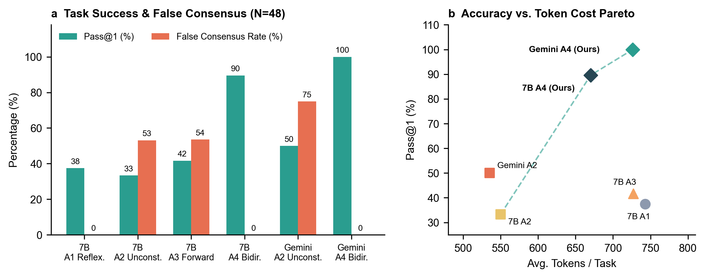

# Bidirectional Epistemic Handoff Gating (`agent-handoff-gate`)

[](https://github.com/frankzhao-io/agent-handoff-gate/actions/workflows/ci.yml)

Suppressing **error propagation**, **false consensus**, and **token inflation** in multi-agent data-analysis and coding pipelines via epistemic state separation (`VERIFIED_*` vs. `ASSUMED_*`) and backward counterexample routing.

---

## Core Mechanism (Beyond Unidirectional ToolGate & Reflexion)

Unconstrained multi-agent pipelines (`Planner → Coder → Reviewer`) frequently suffer from **False Consensus**: an upstream Planner emits a plausible-sounding but false assumption (e.g., wrong CSV column name, unparsed string dtype, or silent join key mismatch), the Coder writes syntactically valid code around it, and the Reviewer approves it—wasting tokens before failing.

Unlike unidirectional execution checks (`ToolGate`, `Reflexion`), **Bidirectional Epistemic Handoff Gating** enforces:
1. **Epistemic State Separation (`VERIFIED_*` vs. `ASSUMED_*`)**: Only sandbox-observed facts (exact CSV schema, column dtypes, distinct object samples, null counts, stdout) may be promoted to `VERIFIED_*`. LLM-inferred claims remain `ASSUMED_*` and cannot be treated as ground truth downstream.
2. **Bidirectional Blame Attribution & Backward Invalidation**: When a downstream gate detects a contradiction or failure, it attributes blame to the originating `ASSUMED_*` claim (`BLAME_PLANNER`) and routes a concrete counterexample **backward to the Planner** for targeted re-planning, rather than letting the Coder patch around a broken premise.

---

## Key Experimental Results

### 1. Benchmark v1 (`N=48`: 8 Clean Controls + 40 Corrupted-Plan Tasks)
| Model | Arm | Pass@1 | False Consensus Rate (FCR) | Error Propagation | Avg Tokens / Task |
| :--- | :--- | :---: | :---: | :---: | :---: |
| `qwen2.5-coder:7b` (RTX 3080) | `A1_Single_Reflexion` | 0.3750 (18/48) | 0.0000 | 0.6250 | 742.8 |
| `qwen2.5-coder:7b` (RTX 3080) | `A2_Unconstrained_3Agent` | 0.3333 (16/48) | 0.5312 | 0.6667 | 550.0 |
| `qwen2.5-coder:7b` (RTX 3080) | `A3_Forward_Only_Gate` | 0.4167 (20/48) | 0.5357 | 0.5833 | 727.2 |
| `qwen2.5-coder:7b` (RTX 3080) | **`A4_Bidirectional_Gate` (Ours)** | **0.8958 (43/48)** | **0.0000** | **0.1042** | 670.1 |
| `gemini-3.5-flash-lite` (Cloud) | `A2_Unconstrained_3Agent` | 0.5000 (24/48) | 0.7500 | 0.5000 | 535.2 |
| `gemini-3.5-flash-lite` (Cloud) | **`A4_Bidirectional_Gate` (Ours)** | **1.0000 (48/48)** | **0.0000** | **0.0000** | 726.3 |

* **Local 7B + Bidirectional Gate (`89.58%`)** outperforms **Ungated Cloud Gemini (`50.00%`, `FCR=0.7500`)** by **+39.58 percentage points** at zero API cost, and reaches `8/8 (100%)` on `C0_clean_control` with zero harm.



### 2. Real-World Third-Party Validation: `InfiAgent-DABench` (`N=25`: 20 Hard + 5 Medium, Zero Injection)
| Model | Arm | Pass@1 | Hard (`N=20`) | Medium (`N=5`) | FCR | Avg Tokens / Task |
| :--- | :--- | :---: | :---: | :---: | :---: | :---: |
| `qwen2.5-coder:7b` | `A2_Unconstrained_3Agent` | 0.3200 (8/25) | 20.0% (4/20) | 80.0% (4/5) | 0.7059 | 2593.0 |
| `qwen2.5-coder:7b` | **`A4_Bidirectional_Gate` (Ours)** | **0.6000 (15/25)** | **50.0% (10/20)** | **100.0% (5/5)** | **0.0000** | 3371.3 |

---

## Repository Structure & Quickstart

```text
agent-handoff-gate/
├── README.md
├── requirements.txt
├── .gitignore
├── src/
│   ├── 01_mvp_fault_injection_bench.py   # MVP 6-task fault-injection generator
│   ├── 02_run_mvp_4arm_ablation.py       # 4-arm ablation runner (A1-A4)
│   ├── 03_benchmark_v1_generator.py      # Benchmark v1 (N=48) generator
│   ├── 04_eval_4arm_benchmark_v1.py      # Local qwen2.5-coder:7b 4-arm evaluator
│   ├── 05_eval_gemini_comparison.py      # Gemini 3.5 Flash-Lite evaluator
│   ├── 06_plot_pareto_and_ablation.py    # Generates Figure 1
│   └── 07_eval_dabench_real.py           # InfiAgent-DABench (N=25) real evaluation
├── tests/
│   └── test_handoff_gate.py              # Unit tests for epistemic gate & sandbox
├── figures/                              # Publication-ready PDF/PNG figures
├── data/                                 # Benchmark manifests & JSON reports
└── notes/
    └── literature-notes.md               # 2025-2026 literature gap analysis
```

```bash
pip install -r requirements.txt
python -m unittest discover -s tests -v

# Local open-source 7B evaluation (Ollama)
ollama pull qwen2.5-coder:7b
python src/04_eval_4arm_benchmark_v1.py
python src/07_eval_dabench_real.py
```
